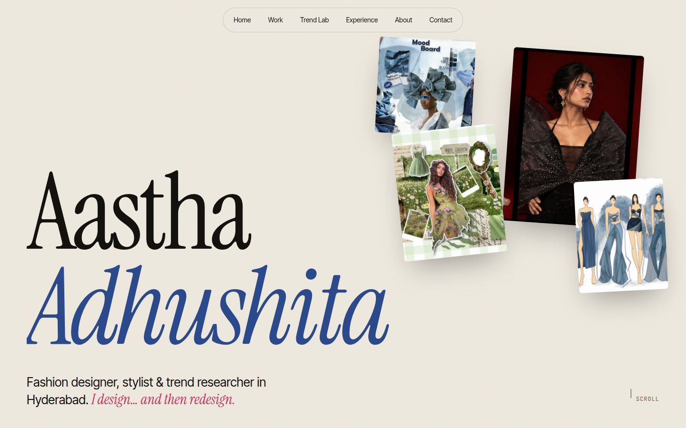
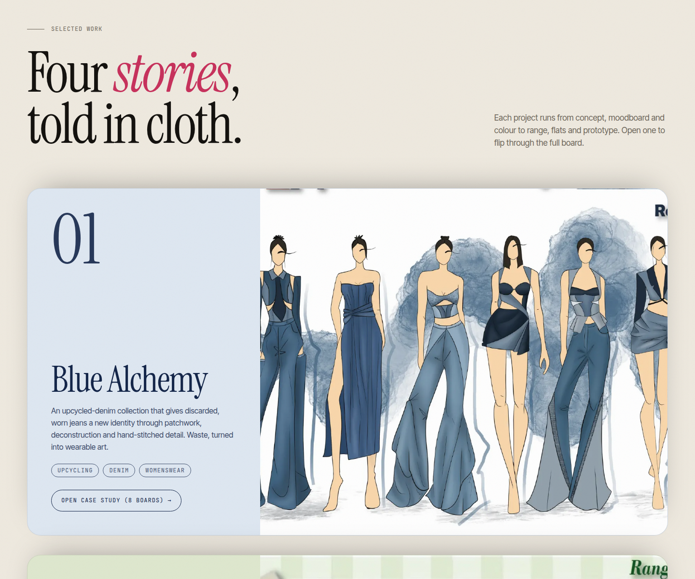
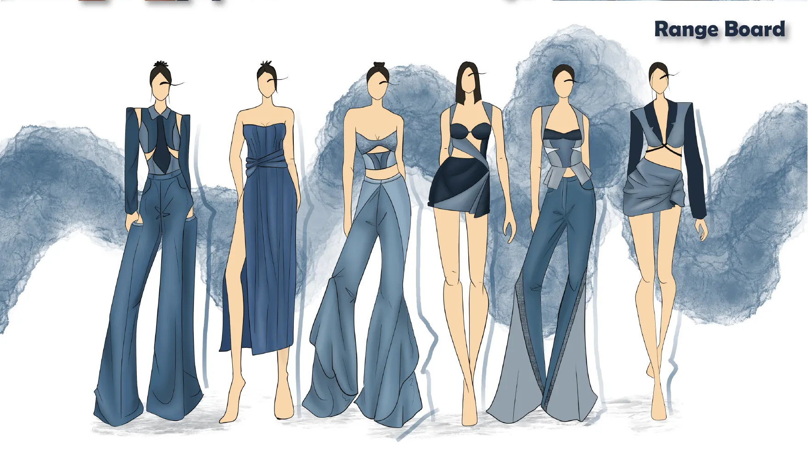
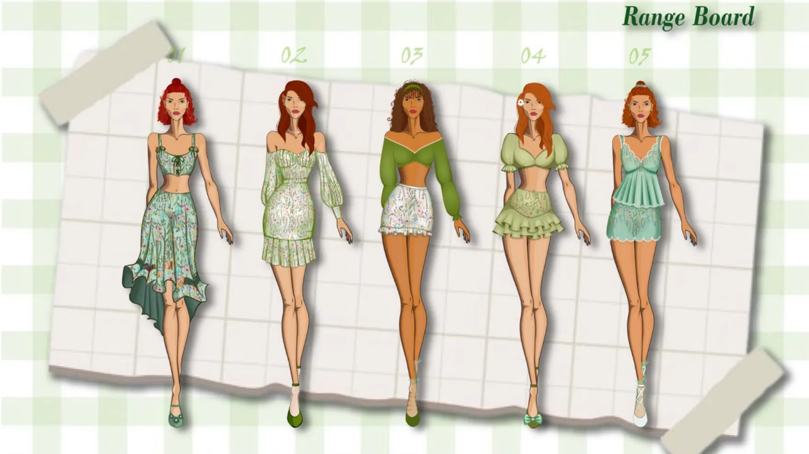
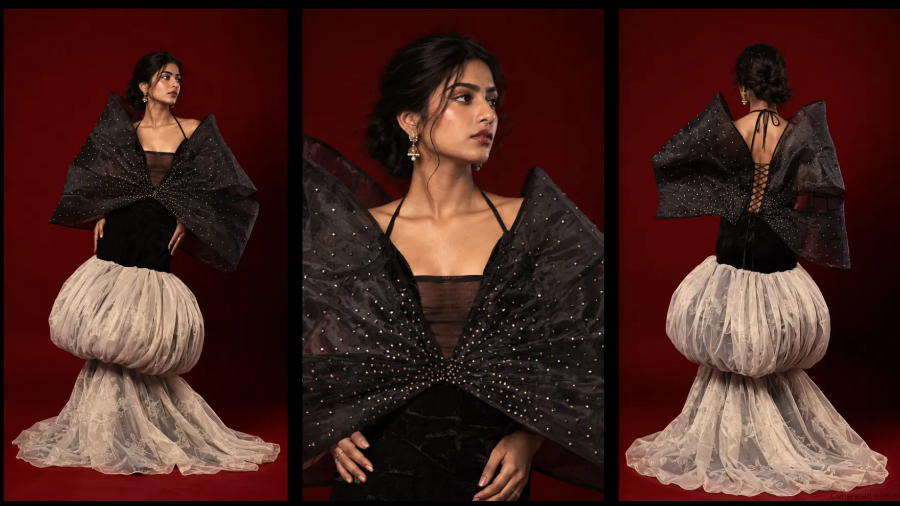
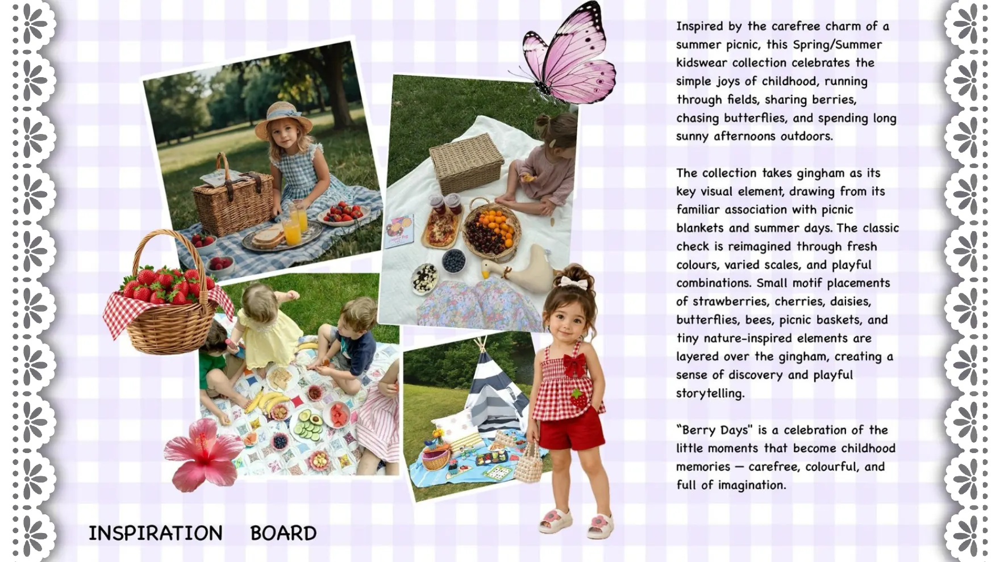
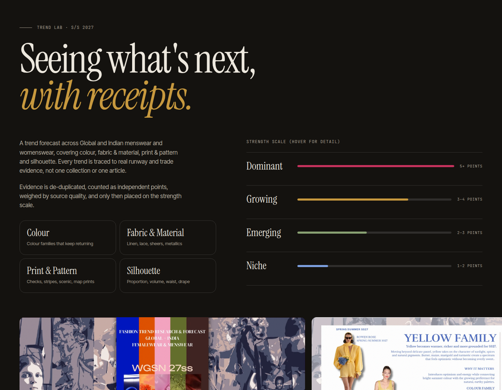
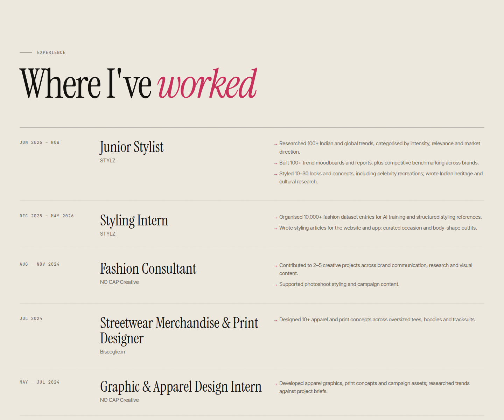
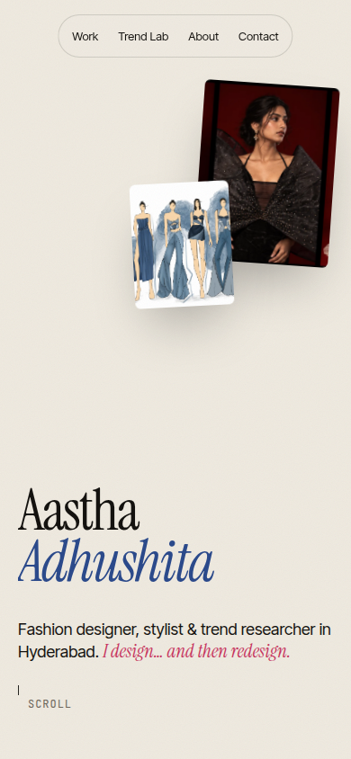

# Aastha Adhushita — Portfolio

A single-page portfolio website for **Aastha Adhushita**, a fashion designer, stylist and trend researcher based in Hyderabad, India. It brings together her design collections, her S/S 2027 trend research and her work experience in one editorial-style page.



## What's on the site

| Section | What it shows |
| --- | --- |
| **Hero** | Name, role, her tagline *"I design… and then redesign"*, and a floating collage of her work |
| **Intro and stats** | Short bio plus headline numbers from her résumé (100+ trends researched, 100+ moodboards and reports, 10,000+ dataset entries, 4 projects) |
| **Selected work** | Four case studies as stacking full-screen cards. Each opens a full-screen viewer with her original boards |
| **Styling portfolio** | Five concept-led styled looks (Poo-core Glam, Grunge Pop Star, Dark Enchantress, Feral Glam, Urban Desi Fusion), each opening a board viewer with credits |
| **Trend Lab** | Her S/S 2027 forecast: the four trend areas, the Dominant / Growing / Emerging / Niche scale, and a draggable strip of report pages |
| **Experience** | Roles at STYLZ, NO CAP Creative and Bisceglie.in |
| **About** | Skills, tools, education, certifications and languages |
| **Contact** | Email link, résumé download, Behance and LinkedIn |

### Selected work



| Blue Alchemy | Iridescent Arbor |
| :---: | :---: |
|  |  |
| Upcycled-denim collection built on patchwork, deconstruction and hand-stitched detail | Women's summer and resortwear in soft pastels and fluid silhouettes (Sep 2023) |

| Path of Revati | Merry Maya for Name It |
| :---: | :---: |
|  |  |
| Couture inspired by the symbolism of Revati Nakshatra | Kidswear for the Danish brand Name It, built on a summer-picnic story and rendered in CLO 3D |

### Trend Lab

The S/S 2027 research covers Global and Indian menswear and womenswear across colour, fabric and material, print and pattern, and silhouette. Each trend is backed by independent runway or trade evidence and then placed on a strength scale.



### Experience



### Mobile

The layout adapts to phone widths.



## Tech

- Plain **HTML, CSS and JavaScript** in one file ([index.html](index.html)). There is no framework, build step or dependencies.
- Fonts from Google Fonts: Instrument Serif, Inter Tight and JetBrains Mono. The page needs an internet connection for these. Without it, it falls back to system fonts.
- Page images are WebP renders of her portfolio and trend-research decks, in [img/](img/).
- Interactions: scroll-reveal animations, sticky stacking project cards, a full-screen project viewer with keyboard navigation (← → and Esc), a draggable report strip, animated counters, and a reduced-motion fallback.

## Run it locally

No install is needed. Open `index.html` in a browser, or serve the folder:

```bash
python3 -m http.server 8000
# then open http://localhost:8000
```

## Deploy

The site is fully static. To publish it with GitHub Pages, go to **Settings → Pages**, choose **Deploy from a branch**, select `main` and the `/ (root)` folder, then save.

## Project structure

```
.
├── index.html          # the whole site (markup, styles, script)
├── Aastha_Resume.pdf   # résumé linked from the Contact section
├── img/
│   ├── d01–d37.webp    # portfolio pages (Blue Alchemy, Iridescent Arbor, Path of Revati, Merry Maya)
│   ├── s*.webp         # styling portfolio pages
│   └── t*.webp         # selected S/S 2027 trend-report pages
└── docs/               # screenshots used in this README
```

## Content and credits

All designs, boards, trend research and copy belong to Aastha Adhushita. Some images inside the trend-research pages are credited to their original publications and designers in the source report. Please don't reuse the work without permission.

Contact: [aasthaadhushita@gmail.com](mailto:aasthaadhushita@gmail.com)
